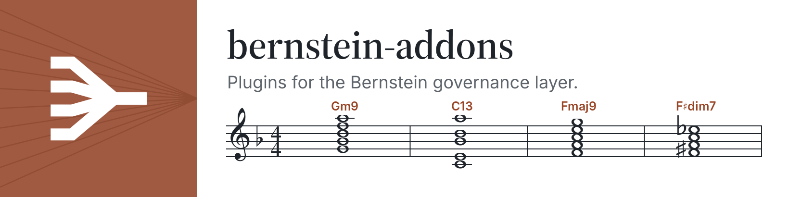

<picture>
  <source media="(prefers-color-scheme: dark)" srcset="https://raw.githubusercontent.com/sipyourdrink-ltd/bernstein-addons/main/docs/assets/readme-banner-dark.webp">
  
</picture>

# bernstein-addons

<a href="https://github.com/sipyourdrink-ltd/bernstein"><picture>  <source media="(prefers-color-scheme: dark)" srcset="https://raw.githubusercontent.com/sipyourdrink-ltd/bernstein/main/assets/brand/badge-plugin-for-dark.svg">  <source media="(prefers-color-scheme: light)" srcset="https://raw.githubusercontent.com/sipyourdrink-ltd/bernstein/main/assets/brand/badge-plugin-for-light.svg">  </picture></a>

Plugins for [Bernstein](https://pypi.org/project/bernstein/), the open-source governance layer for AI agents. Each plugin is a separate Python package under `plugins/` with its own README and tests.

These packages are not currently published on PyPI.

| Plugin | Package | Current tag | What it does | Bernstein requirement / integration |
|---|---|---|---|---|
| [role-pack](plugins/role-pack/README.md) | `bernstein-role-pack` | `role-pack-v0.1.0` | Role registry with reporting lines, a receipt ledger where `done` needs an acceptance by an allowed reviewer bound to the file's sha256, a rule against replaying unknown tasks under a new id, and the quality gate `role_pack_acceptance` | `>=3.24,<5`; plugin and gate entry points |
| [org-kit](plugins/org-kit/README.md) | `bernstein-org-kit` | `org-kit-v0.2.0` | Starter org kit across 6 presets (`minimal`, `engineering`, `secops`, `product`, `compliance`, `full`: up to 36 roles, 16 SOPs, 20 workflows, 32 scenarios, 9 authoring templates), auto-generated `roles.toml`, deterministic SHA-256 workflow DAG compiler, fail-closed stage runner over Bernstein's native CLI adapters, and `AGENTS.md` governance hook | `>=3.24,<5` + `bernstein-role-pack>=0.1.0`; plugin entry point and CLI |
| [Sandcastle](plugins/sandcastle/README.md) | `bernstein-sandcastle` | `sandcastle-v0.1.0` | Records run evidence and leaves merges to Bernstein's gates | No Python Bernstein dependency declared; task-attempt CLI integration |
| [brand-gate](plugins/brand-gate/README.md) | `bernstein-brand-gate` | `brand-gate-v0.1.0` | Opt-in configured-domain check using `brand-impersonation-detector`; requires explicit tool mapping and host enforcement; records checked verdicts if the journal is writable | `>=3.24.1,<5`; pre-tool hook or explicit CLI |

Brand-gate invokes the classifier only for a valid destination in a supported environment after enablement and tool selection. It allows only a validated `legit` verdict with `signals.domain_is_legit = true` and a successful journal append. Unrelated domains can block; an allow result does not establish website safety. See [brand-gate installation and configuration](plugins/brand-gate/README.md#install) for source installation and host wiring.

## Install without cloning

Each plugin installs directly from GitHub on Python 3.12 or newer using `#subdirectory=` pinned to its per-package git tag:

```sh
# bernstein-role-pack
pip install "bernstein-role-pack @ git+https://github.com/sipyourdrink-ltd/bernstein-addons@role-pack-v0.1.0#subdirectory=plugins/role-pack"

# bernstein-org-kit (depends on bernstein-role-pack>=0.1.0, which is not on PyPI; pass both URLs in one command)
pip install \
  "bernstein-role-pack @ git+https://github.com/sipyourdrink-ltd/bernstein-addons@role-pack-v0.1.0#subdirectory=plugins/role-pack" \
  "bernstein-org-kit @ git+https://github.com/sipyourdrink-ltd/bernstein-addons@org-kit-v0.2.0#subdirectory=plugins/org-kit"

# bernstein-brand-gate
pip install "bernstein-brand-gate @ git+https://github.com/sipyourdrink-ltd/bernstein-addons@brand-gate-v0.1.0#subdirectory=plugins/brand-gate"

# bernstein-sandcastle
pip install "bernstein-sandcastle @ git+https://github.com/sipyourdrink-ltd/bernstein-addons@sandcastle-v0.1.0#subdirectory=plugins/sandcastle"
```

## Per-package tag scheme

All four plugins live in this repository and version independently using `<plugin-dir>-v<version>` git tags matching `[project].version` in `plugins/<plugin-dir>/pyproject.toml` (`role-pack-v0.1.0`, `org-kit-v0.2.0`, `brand-gate-v0.1.0`, `sandcastle-v0.1.0`). No umbrella `bernstein-addons` Python package exists. Tags are cut on `main` after review and green CI, and are never moved once pushed; see [docs/tag-scheme.md](docs/tag-scheme.md).

## Quickstart: role-pack and org-kit demos

Without cloning:

```sh
python3.12 -m venv .venv
. .venv/bin/activate
pip install "bernstein==4.0.0"
pip install \
  "bernstein-role-pack @ git+https://github.com/sipyourdrink-ltd/bernstein-addons@role-pack-v0.1.0#subdirectory=plugins/role-pack" \
  "bernstein-org-kit @ git+https://github.com/sipyourdrink-ltd/bernstein-addons@org-kit-v0.2.0#subdirectory=plugins/org-kit"
bernstein-role-pack demo
bernstein-org-kit demo
```

From a local clone (for development and editable installs):

```sh
git clone https://github.com/sipyourdrink-ltd/bernstein-addons.git
cd bernstein-addons
python3.12 -m venv .venv
. .venv/bin/activate
pip install "bernstein==4.0.0" -e ./plugins/role-pack -e ./plugins/org-kit
bernstein-role-pack demo
bernstein-org-kit demo
```

## Tests

The workflow in `.github/workflows/test.yml` runs on Python 3.12. The `role-pack`, `org-kit`, `brand-gate`, and `git-url-install` jobs each run twice, once with Bernstein 3.24.1 and once with 4.0.0. The `role-pack` job installs that plugin, runs its unittest suite and runs its demo. The `org-kit` job installs `role-pack` and `org-kit`, runs its unittest suite and zero-config demo, builds its wheel, and checks CLI help. The `git-url-install` job verifies README tag pins against each `pyproject.toml` and runs each documented `git+https://...#subdirectory=` install command in a clean Python 3.12 virtual environment followed by `--help`. The `contract-tests` job runs Sandcastle's stubbed contract tests with Node 22, then checks the installed Python package, CLI help, packaged runtime files and npm dependency import. It does not run a Sandcastle agent or provider.

The `brand-gate` job pins the matrix Bernstein version and `brand-impersonation-detector` 0.1.1 on Python 3.12, runs its tests, builds its wheel, and checks CLI help. During each test, Python socket connection methods and DNS lookup are patched to fail; this is not OS network isolation. These pins are tested versions, distinct from the declared dependency ranges above.

## Licence

Apache-2.0. See `LICENSE` and `NOTICE`.
