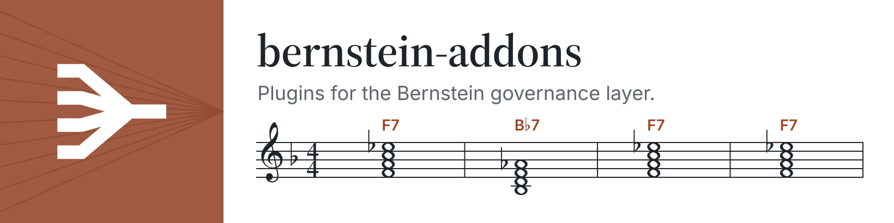

<picture>
  <source media="(prefers-color-scheme: dark)" srcset="https://raw.githubusercontent.com/sipyourdrink-ltd/bernstein-addons/main/docs/assets/readme-banner-dark.webp">
  
</picture>

# bernstein-addons

<a href="https://github.com/sipyourdrink-ltd/bernstein"><picture>  <source media="(prefers-color-scheme: dark)" srcset="https://raw.githubusercontent.com/sipyourdrink-ltd/bernstein/main/assets/brand/badge-plugin-for-dark.svg">  <source media="(prefers-color-scheme: light)" srcset="https://raw.githubusercontent.com/sipyourdrink-ltd/bernstein/main/assets/brand/badge-plugin-for-light.svg">  </picture></a>

Plugins for [Bernstein](https://pypi.org/project/bernstein/), the open-source governance layer for AI agents. Each plugin is a separate Python package under `plugins/` with its own README, tests and demo.

| Plugin | Package | What it does | Bernstein |
|---|---|---|---|
| [role-pack](plugins/role-pack/README.md) | `bernstein-role-pack` | Role registry with reporting lines, a receipt ledger where `done` needs an acceptance by an allowed reviewer bound to the file's sha256, a rule against replaying unknown tasks under a new id, and the quality gate `role_pack_acceptance` | 3.24.1 |
| [Sandcastle](plugins/sandcastle/README.md) | `bernstein-sandcastle` | Records run evidence and leaves merges to Bernstein's gates | Task-attempt CLI |

## Quickstart

```
git clone https://github.com/sipyourdrink-ltd/bernstein-addons.git
cd bernstein-addons
python3.12 -m venv .venv
. .venv/bin/activate
pip install "bernstein==3.24.1"
pip install ./plugins/role-pack
bernstein-role-pack demo
```

## Tests

The workflow in `.github/workflows/test.yml` installs each plugin with Bernstein 3.24.1 on Python 3.12, runs its unittest suite and its demo.

## Licence

Apache-2.0. See `LICENSE` and `NOTICE`.
