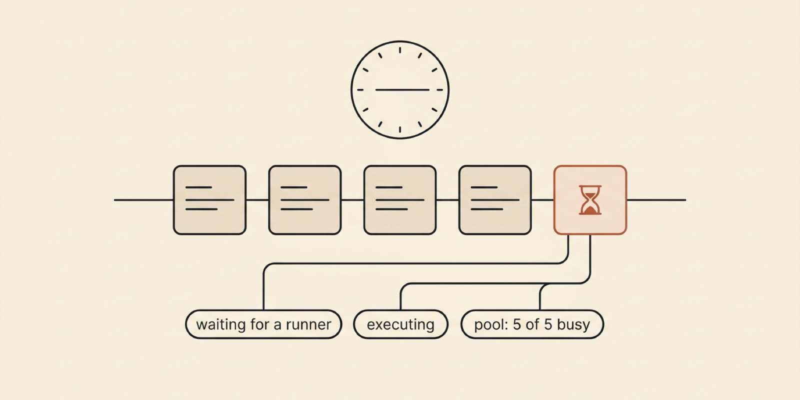

# bernstein-merge-queue-stall-guard

A read-only watcher for GitHub's native merge queue. It reports a stall when entries are present, nothing has merged for N hours and the head is not red; then it names the head entry, each pending check, whether the wait is for a runner or for execution, and the hosted-runner pool census by label. It never dequeues, cancels, relabels or edits queue settings.

<picture>
  <source media="(prefers-color-scheme: dark)" srcset="assets/diagram-dark.png">
  <source media="(prefers-color-scheme: light)" srcset="assets/diagram-light.png">
  
</picture>

## Install

`bernstein-merge-queue-stall-guard` is not currently published on PyPI. Install directly from GitHub pinned to its per-package git tag on Python 3.12 or newer:

```sh
pip install "bernstein-merge-queue-stall-guard @ git+https://github.com/sipyourdrink-ltd/bernstein-addons@merge-queue-stall-guard-v0.1.0#subdirectory=plugins/merge-queue-stall-guard"
```

Requires the official GitHub CLI (`gh`) authenticated with read access to repository contents, pull requests, and Actions runs/jobs.

## Usage

```sh
merge-queue-stall-guard --repo example-org/example-repo --branch main --stall-hours 2
```

JSON output (validated against [schema/report.schema.json](schema/report.schema.json)):

```sh
merge-queue-stall-guard --repo example-org/example-repo --format json --no-state
```

### Options

| Flag | Default | Description |
|---|---|---|
| `--repo` | `$MQSG_REPO` | Target repository in `owner/name` form (required) |
| `--branch` | `main` | Protected branch with merge queue enabled |
| `--stall-hours` | `2` | Hours without a merge before reporting a stall |
| `--alert-repeat-hours` | `4` | Minimum hours between repeated rows in `alerts.jsonl` |
| `--state-dir` | `$XDG_STATE_HOME/merge-queue-stall-guard` | Directory for local history, stall marker, and throttled alerts |
| `--no-state` | off | Skip writing local state files (useful in CI) |
| `--format` | `text` | Output format: `text` or `json` |
| `--gh-bin` | `gh` | Path to the `gh` CLI binary |

### Exit codes

| Code | Verdict | Meaning |
|---|---|---|
| `0` | `healthy` / `blocked-red` | Queue empty, merges flowing inside the window, or head entry held back by failing checks |
| `1` | `stall` | Entries present, nothing merged for `--stall-hours`, and head entry is not red |
| `2` | `unknown` | Cannot read queue or branch tip (for example, `gh` absent or API error) |

## GitHub Actions example

Copy [examples/stall-guard.yml](examples/stall-guard.yml) into `.github/workflows/` to run on a schedule and write the JSON report to the job summary using read-only `GITHUB_TOKEN` permissions (`contents: read`, `pull-requests: read`, `actions: read`).

## Development and tests

```sh
pip install -e ./plugins/merge-queue-stall-guard
pytest plugins/merge-queue-stall-guard/tests -v
ruff check plugins/merge-queue-stall-guard
mypy --strict plugins/merge-queue-stall-guard/src
```

## Licence

Apache-2.0.
